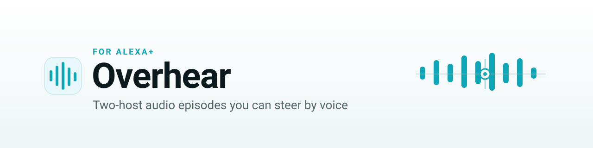
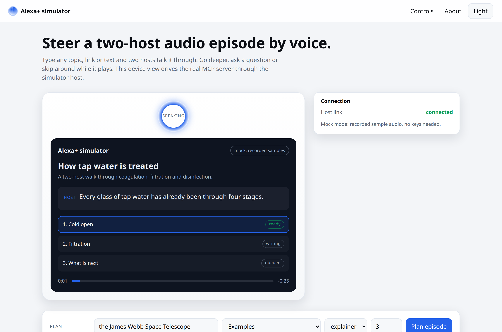
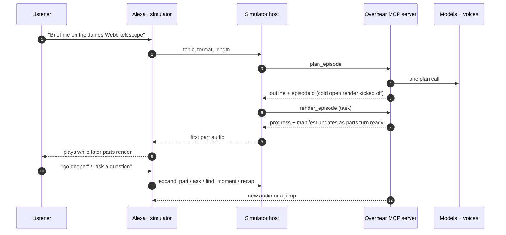
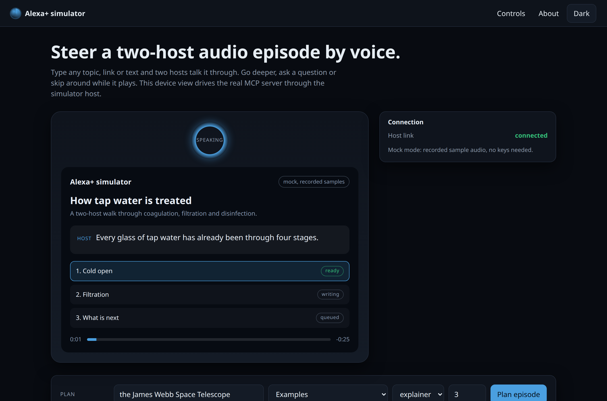
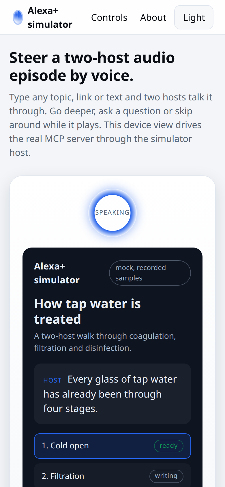
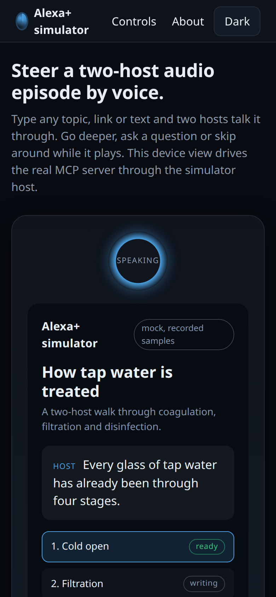
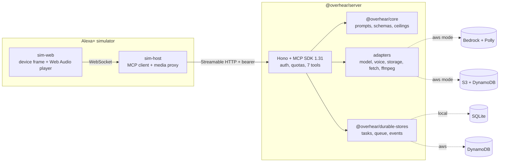

<!-- SPDX-License-Identifier: Apache-2.0 -->
<p align="center">
  <picture>
    <source media="(prefers-color-scheme: dark)" srcset="docs/assets/banner-dark.svg">
    
  </picture>
</p>

<p align="center">
  <a href="#try-it-in-one-command"></a>
  <a href="#use-it-on-your-echo"></a>
</p>

<p align="center">
  <a href="#how-it-works">How it works</a> ·
  <a href="#use-it-on-your-echo">On your Echo</a> ·
  <a href="#tools-resources-and-prompts">Tools</a> ·
  <a href="#mcp-conformance">Conformance</a> ·
  <a href="docs/ARCHITECTURE.md">Architecture</a> ·
  <a href="SECURITY.md">Security</a>
</p>

<p align="center">
  
  
  
  
  
  
</p>

---

<h3 align="center">The podcast you can interrupt.</h3>

**Overhear is a self-hosted MCP server that turns any topic, link or document into a two-host audio episode you steer by voice.** Ask about anything, pick a format, then two synthetic hosts talk it through while you skip around, go deeper or ask a question out loud. It speaks the newest Model Context Protocol, 2025-11-25, over Streamable HTTP, with seven tools, four resources and four prompts behind one bearer token. **The first part starts playing while the rest are still being written**, so you are listening in seconds instead of waiting for the whole episode.

> **Why now.** The 2025-11-25 MCP revision made long-running work first class with a tasks API. Overhear is built on it: rendering an episode is a task you watch, cancel and resume, not a call that blocks. The conformance suite checks that surface against the raw wire, **28 of 34** rows, with every non-advisory row passing.

<p align="center">
  <picture>
    <source media="(prefers-color-scheme: dark)" srcset="docs/assets/screens/sim-dark-1360.png">
    
  </picture>
</p>

## Try it in one command

Linux or macOS (Windows: use WSL), with **Node 22+** and **ffmpeg** installed:

```bash
curl -fsSL https://raw.githubusercontent.com/zkasuran/overhear-alexa/main/install.sh | bash
```

That clones the repo, installs, builds and opens a menu. The same thing by hand:

```bash
git clone https://github.com/zkasuran/overhear-alexa && cd overhear-alexa && ./overhear.sh
```

| Menu          | What it does                                                                                                          | Needs                                        |
| ------------- | --------------------------------------------------------------------------------------------------------------------- | -------------------------------------------- |
| 1 `demo`      | Mock mode: the full product with recorded-sample audio. Opens the simulator at 127.0.0.1:5173                         | nothing                                      |
| 2 `live`      | Real **Amazon Polly** voices and real scripts on any topic                                                            | AWS credentials for Polly, plus a text model |
| 3 `echo`      | Live mode on **your own Echo** through the Overhear Studio skill (see [below](#use-it-on-your-echo))                  | an Echo and an Amazon developer login        |
| 4 `configure` | Asks for the region, AWS profile and script model (Bedrock Nova, or any OpenAI-compatible API), checks each one works |                                              |
| 5-8           | `status`, `logs`, `stop`, `verify` (the full release gate)                                                            |                                              |

Every option also runs directly, for example `./overhear.sh demo` or `./overhear.sh stop`. Keys are asked for once, stored in `~/.config/overhear/` with mode 600 and read from files, never from the command line.

### Then, in the simulator (http://127.0.0.1:5173)

|     | Do this                                                                            | You will see                                                                                             |
| --- | ---------------------------------------------------------------------------------- | -------------------------------------------------------------------------------------------------------- |
| 1   | Type **any topic**, paste a **https:// link** or some text, press **Plan episode** | A titled outline in seconds (the Examples menu fills in ideas)                                           |
| 2   | Press **Play**                                                                     | Part 1 plays while the later parts are still being written; each part flips to `ready`                   |
| 3   | Press **Go deeper**, **Skip**, **Back** or **Time left**                           | A deeper part is inserted right after the current one, or playback jumps, without stopping               |
| 4   | Type a question, for example "what did they say about the mirror?"                 | A spoken answer grounded only in the source and what the hosts said, or "the episode did not cover that" |

The badge on the device says **mock** or **live, Amazon Polly voices**, so the run mode is never ambiguous. Prefer Docker? `docker compose up` runs the demo mode the same way.

## How it works



1. **Plan.** `plan_episode` turns a topic, a URL or a document into a titled outline in one model call, then kicks a speculative render of the cold open so the first audio is ready fast.
2. **Render.** `render_episode` is a long-running task. Parts are scripted, voiced and mixed in playback order. The manifest resource updates as each part turns ready, so playback starts on part one.
3. **Steer.** While it plays, `find_moment` jumps around, `expand_part` adds a deeper follow-up, `recap` sums up what you have heard and `ask` answers a question grounded only in the source and the transcript.
4. **Carry on.** Every task is bound to the caller and survives a reconnect through the durable store, so a dropped stream resumes instead of starting over.

<table>
  <tr>
    <td width="50%"><p align="center"><sub><b>Light, desktop.</b> The orb, the episode card, the player and the plan controls.</sub></p></td>
    <td width="50%"><p align="center"><sub><b>Dark, desktop.</b> The same view, themed from system preference and a persisted toggle.</sub></p></td>
  </tr>
  <tr>
    <td width="50%"><p align="center"><sub><b>Light, phone.</b> One column, the device frame and the outline stacked.</sub></p></td>
    <td width="50%"><p align="center"><sub><b>Dark, phone.</b> Parts show their status: ready, writing, queued.</sub></p></td>
  </tr>
</table>

## Tools, resources and prompts

Seven tools, four resources and four prompts, every one with its own icon in `tools/list`, so a generic MCP client can discover and drive the whole product with no docs. The task column says how a tool runs: a sync tool answers at once, a required-task tool only runs as a watchable task, an optional-task tool can do either.

|                                                                                | Tool             | What it does                                                                       | Runs as         |
| ------------------------------------------------------------------------------ | ---------------- | ---------------------------------------------------------------------------------- | --------------- |
|    | `plan_episode`   | Turn a topic, URL or text into a titled two-host outline in one pass               | sync            |
|  | `render_episode` | Script, voice and mix the planned parts in playback order                          | task (required) |
|     | `get_episode`    | Read an episode and its parts, with the lines on request                           | sync            |
|     | `find_moment`    | Resolve a spoken request like "back 30 seconds" or "the history bit" to a position | sync            |
|     | `expand_part`    | Add a deeper follow-up to one part, inserted right after it                        | task (required) |
|           | `recap`          | A short spoken recap of what has been heard up to a point                          | task (optional) |
|             | `ask`            | Answer a question grounded only in the source and the transcript, with citations   | task (optional) |

Four resources. The three per-episode resources are owner scoped and read "not found" for anyone else; the manifest and transcript are subscribable, so a client is told the moment a part changes status.

|                                                                            | Resource                              | What it is                                                                                   |
| -------------------------------------------------------------------------- | ------------------------------------- | -------------------------------------------------------------------------------------------- |
|    | `overhear://episodes/{id}/manifest`   | The playback source of truth: the episode and its parts, no per-line detail. Subscribable    |
|  | `overhear://episodes/{id}/transcript` | Speaker-labelled transcript of the ready parts, each line tagged for citations. Subscribable |
|      | `overhear://episodes/{id}/source`     | The normalised source text the episode was built from                                        |
|     | `overhear://formats`                  | The four show formats, their two voices and musical mood                                     |

Four prompts, one per format, so a plain MCP client finds the product without reading this page. Each expands to a single message that calls `plan_episode` with that format.

|                                                                           | Prompt      | Format                                                            |
| ------------------------------------------------------------------------- | ----------- | ----------------------------------------------------------------- |
|   | `brief_me`  | Curious explainer: a warm host and a sharp expert unpack one idea |
|  | `debate_it` | Two-sided debate: each voice steel-mans one side, fairly          |
|  | `wind_down` | Cozy wind-down: a calm, unhurried take for the end of the day     |
|    | `hype_it`   | Hype trailer: punchy, high-energy, momentum that keeps building   |

## What is real and what is simulated

The device is the only simulated piece. Everything it calls is the real server. The mock twins are labelled in the product.

| Real                                                                                                  | Simulated or mocked, labelled                                                                                                                                                                          |
| ----------------------------------------------------------------------------------------------------- | ------------------------------------------------------------------------------------------------------------------------------------------------------------------------------------------------------ |
| The MCP server and its Streamable HTTP transport, protocol 2025-11-25                                 | The Alexa+ device. The web client and the host stand in for the Alexa+ surface; the same server also runs on a real Echo through a development skill (see [Use it on your Echo](#use-it-on-your-echo)) |
| The seven tools, the four resources, the four prompts and the task lifecycle                          | Mock models: `OVERHEAR_MODELS=mock` swaps in deterministic text and voice twins, labelled "recorded sample" in the UI                                                                                  |
| The SQLite durable stores, the ffmpeg audio mixer and the SSRF-guarded source fetcher                 | The mock audio is a real short MP3 sized to the text, not silence, so a judge hears the product                                                                                                        |
| In AWS mode: Amazon Bedrock (Nova), Amazon Polly, Amazon S3 and Amazon DynamoDB, each called for real | `GET /health` and the startup banner print the models mode and the store mode, so the run mode is never ambiguous                                                                                      |

## MCP conformance

A client in `@overhear/conformance` checks the 2025-11-25 wire over raw HTTP, JSON-RPC and manual SSE, with no MCP SDK on the test side, so it tests the protocol and not the library. The matrix has 34 rows across four groups: C (transport and lifecycle), L (tools listing), T (tasks) and R (resources). It passes **28 of 34**, with every non-advisory row passing. The remaining rows are advisory. Each rests either on a spec SHOULD or MAY or on behaviour a single client cannot observe, such as the loopback bind, the SSE retry field or a forced task failure. Those rows report skip, never fail.

| Row  | Checks                                                                                         | Result |
| ---- | ---------------------------------------------------------------------------------------------- | ------ |
| C-1  | `initialize` negotiates 2025-11-25, session id is visible ASCII                                | pass   |
| C-3  | a present, non-allowlisted `Origin` gets 403                                                   | pass   |
| C-7  | an unknown `MCP-Session-Id` gets 404                                                           | pass   |
| L-1  | `tools/list` exposes 7 tools, each with input schema, output schema and icons                  | pass   |
| L-2  | `taskSupport` mapping: render and expand required, recap and ask optional                      | pass   |
| T-3  | a render task begins `working`, its ttl is capped, timestamps are ISO 8601                     | pass   |
| T-8  | cancel moves a task to `cancelled`, a second cancel gets -32602                                | pass   |
| T-10 | a second principal cannot get, result or cancel your task; `tasks/list` hides it               | pass   |
| R-1  | three `{id}` templates in `resources/templates/list`, `overhear://formats` in `resources/list` | pass   |
| R-3  | reading another principal's manifest is "not found" (-32002)                                   | pass   |

```bash
node packages/conformance/dist/cli.js http://127.0.0.1:8787/mcp \
  --token-file fixtures/test-token --token2-file fixtures/test-token2 --timeout 60000
```

The second token enables the two isolation rows (T-10 and R-3). Exit code 0 means every non-advisory row passed.

## Architecture



One core holds every rule with no I/O. The server, the conformance client and the simulator all speak the same wire, so a terminal and the device can never disagree about an episode. The full package map and the request walkthrough are in [docs/ARCHITECTURE.md](docs/ARCHITECTURE.md).

## Run it locally

`./overhear.sh` does all of this for you. To run the three processes by hand, with Node 22 and ffmpeg on the path:

```bash
npm ci
npm run build

# 1. the MCP server, mock models and local store, no AWS keys
OVERHEAR_MODELS=mock OVERHEAR_STORE=local node packages/server/dist/main.js   # 127.0.0.1:8787

# 2. the simulator host, in a second terminal (reads the committed dev token file)
node packages/sim-host/dist/main.js                                          # 127.0.0.1:8788

# 3. the simulator UI, in a third terminal
npm run preview -w @overhear/sim-web                                         # 127.0.0.1:5173
```

Open **http://127.0.0.1:5173**. The server binds loopback only unless `OVERHEAR_BIND_PUBLIC=1`. Every request still needs the bearer token.

## Live mode

`./overhear.sh configure` sets this up interactively. Live mode speaks with **Amazon Polly generative voices** and writes the scripts with either **Amazon Bedrock (Nova)** or any OpenAI-compatible endpoint. Both text providers sit behind the same adapter seam, so switching is one env value.

```bash
# Polly voices + Bedrock Nova scripts
AWS_REGION=us-west-2 OVERHEAR_MODELS=aws OVERHEAR_STORE=local node packages/server/dist/main.js

# Polly voices + scripts from an OpenAI-compatible endpoint (GMI Cloud by default)
echo "$YOUR_KEY" > ~/.overhear-text.key && chmod 600 ~/.overhear-text.key
AWS_REGION=us-west-2 OVERHEAR_MODELS=aws OVERHEAR_STORE=local \
  OVERHEAR_TEXT=openai OVERHEAR_OPENAI_KEY_FILE=~/.overhear-text.key \
  node packages/server/dist/main.js
```

`GET /health` reports which text model and which speech engine are live, and the simulator badge switches from "mock" to "live". The recorded demo runs the second command: Amazon Polly voices every line, and `deepseek-ai/deepseek-v4.1-flash-1017` on GMI Cloud writes the scripts, because Bedrock model invocation is still pending account verification on the demo account. A full live session (plan, render, find, ask) passed `scripts/e2e-session.mjs` in 21 s. The AWS calls, table design and a least-privilege IAM policy are in [docs/AWS.md](docs/AWS.md).

## Use it on your Echo

Overhear also runs on a real Echo through a development Alexa skill, **Overhear Studio**. A development skill needs no certification: it works on every Echo signed in to your Amazon developer account.

**Set it up (about 3 minutes):**

1. Sign in to your Echo and to [developer.amazon.com](https://developer.amazon.com) with the **same Amazon account**. The Echo's language must be English (US, India, UK, Australia or Canada).
2. Run `./overhear.sh echo`. It configures live mode if needed, installs the Alexa Skills Kit CLI and `cloudflared` if missing, then:
   - opens a browser for `ask configure`: sign in, press **Allow**, keep profile `default`, and answer **No** to "link your AWS account" (the skill runs on your machine, not in AWS);
   - starts a free https tunnel so the Echo can reach this machine;
   - creates the Overhear Studio skill, points it at the tunnel and starts the skill endpoint.
3. Talk to the Echo:

| Say                                                                                           | What happens                                                                |
| --------------------------------------------------------------------------------------------- | --------------------------------------------------------------------------- |
| "Alexa, open overhear studio", then "brief me on **any topic**"                               | `plan_episode` writes an outline and `render_episode` starts as an MCP task |
| about 10 seconds later: "Alexa, ask overhear studio to play"                                  | the first part streams to the Echo as soon as it is voiced                  |
| "Alexa, tell overhear studio to go deeper"                                                    | `expand_part` adds a deeper part, which plays right after this one          |
| "Alexa, ask overhear studio what did they say about _something_"                              | `ask` answers from the source and the transcript, then the episode resumes  |
| "Alexa, ask overhear studio how long is left", "Alexa, next", "Alexa, pause", "Alexa, resume" | answered on the endpoint, no model call                                     |

If Alexa answers "I'm not sure how to help with that", open the Alexa app, go to **More > Skills & Games > Your Skills > Dev**, check that Overhear Studio is listed and enabled, and check the Echo's language. Keep the machine awake while you use the Echo.

How it works: the skill endpoint (`packages/sim-host/src/alexa/`) maps each spoken request to an MCP tool on the same server, streams each part with the AudioPlayer interface and queues the next part, including a deeper part `expand_part` just inserted, when the current one nearly ends. Every request is checked the way the Alexa Skills Kit requires for a self-hosted endpoint: certificate URL, certificate chain and name, RSA SHA-256 signature over the body, a 150 s timestamp window and the skill id. Alexa allows a skill about 8 seconds per answer, so while a part is still being voiced the skill says so and you ask again; a slow answer to a question is kept and returned the next time you ask it.

## Command line

With the server from step 1 running, drive the real tool-call order over the wire, no browser:

```bash
# a full session: initialize, plan, render as a task, wait for playable audio,
# find a moment, ask a grounded question, read it back, fetch the served MP3
node scripts/e2e-session.mjs --mock

# the MCP 2025-11-25 conformance matrix against the same URL
node packages/conformance/dist/cli.js http://127.0.0.1:8787/mcp \
  --token-file fixtures/test-token --token2-file fixtures/test-token2 --timeout 60000
```

The token is read from a file, never from argv or an env value, so it cannot leak into a process listing or a log.

## Built to be attacked

The threat model is in **[SECURITY.md](SECURITY.md)**: one row per attacker and attack, the defence, the file that holds it and the test that proves it. Known limits are stated plainly, not hidden.

- **Auth that leaks nothing.** Tokens live on disk only as SHA-256 digests. The presented token is compared in constant time, so a wrong token leaks neither its value nor its length through timing.
- **Per-principal budgets.** Episodes per day, concurrent tasks and tool calls per minute are capped per bearer principal. Over budget is a speakable error, never a crash.
- **No SSRF.** A `url` source is https only. Every resolved address is checked against loopback, private, link-local, CGNAT, ULA and cloud-metadata ranges, the IP is pinned through the socket, every redirect is re-checked, the body is capped and the fetch is timed out.
- **Owner-scoped stores.** Every episode, session and task carries its owner in the query, ids are 128-bit CSPRNG. A foreign principal reads "not found", never another principal's data.
- **Prompt injection is contained.** The source is wrapped in a delimited data block, every model reply is parsed back through a strict schema. No tool has a side effect beyond generating audio for the caller's own episode.
- **No shell, ceilings everywhere.** ffmpeg runs through `execFile` with an argv array, every untrusted size, count and length has a named ceiling. Parsers return a typed error rather than throwing on hostile input.
- **Supply chain.** Direct dependencies are pinned and both lockfiles are committed. The gate fails on any high `npm audit` finding or any dependency off the licence allowlist.

```bash
./verify.sh    # prints ALL GREEN only at the end; CI runs exactly this script
```

The gate runs, in order: format, typecheck (server and web), lint with warnings denied, the unit and property tests, the licence check, the intel gate, `npm audit`, the build, then it boots the server in mock mode and runs the conformance matrix, the end-to-end session and the headless-Chrome UI gate in both themes at 390 and 1360 wide. `./verify.sh --live` adds the AWS adapter contract tests against real Bedrock, Polly, S3 and DynamoDB.

## Repository

```
packages/core             the rules with no I/O: ceilings, ids, formats, prompts, timeline, JSON extractor
packages/durable-stores   task store, task queue and resumable event store (SQLite + DynamoDB), also published on its own as mcp-durable-stores
packages/server           the MCP server: HTTP, transport, auth, quotas, 7 tools, resources, prompts, adapters
packages/conformance      the MCP 2025-11-25 conformance client (raw HTTP + JSON-RPC + SSE, no SDK)
packages/sim-host         the device-side MCP client, token holder and media proxy
packages/sim-web          the Alexa+ simulator UI (Vite): device frame, Web Audio player, captions, outline
docs/AWS.md               the AWS calls, table design and a least-privilege IAM policy
docs/ARCHITECTURE.md      the package map and the request walkthrough
SECURITY.md               threat model, defences and known limits
verify.sh                 the one release gate
overhear.sh               the launcher: demo, live, echo, configure, status, logs, stop, verify
install.sh                one-line bootstrap: clone, then open the launcher
```

## Roadmap

- [x] MCP 2025-11-25 over Streamable HTTP: 7 tools, 4 resources, 4 prompts, the task lifecycle
- [x] Mock models and local store as the default, so the whole product runs with no AWS account
- [x] AWS mode on Amazon Bedrock (Nova), Polly, S3 and DynamoDB, with a least-privilege policy
- [x] The Alexa+ simulator: a gapless Web Audio player, ducking, captions and a steer-by-voice surface
- [x] A real Echo: the Overhear Studio development skill on the same MCP server
- [ ] Live Nova Sonic speech-to-speech in the simulator host, in place of the push-to-talk fallback
- [ ] OAuth 2.1 authorization alongside the static bearer tokens
- [ ] A shared rate limiter so budgets hold across more than one replica

## Open-source spin-off

The durable stores behind the task lifecycle are published as a standalone Apache-2.0 library, [mcp-durable-stores](https://github.com/zkasuran/mcp-durable-stores): SQLite and DynamoDB versions of the MCP SDK's `EventStore`, `TaskStore` and `TaskMessageQueue`, plus a conformance suite any other store can run against itself. The SDK ships only in-memory versions, which lose every task and resumable stream on a restart.

## Licence

Apache License 2.0, see [LICENSE](LICENSE). Copyright 2026 zkasuran. Every package in this repository, including the `packages/durable-stores` workspace, ships under the same licence. Third-party terms are recorded in [DATA-SOURCES.md](DATA-SOURCES.md) and [NOTICE](NOTICE).

<p align="center"><sub>Overhear for Alexa+ · a self-hosted MCP server for two-host audio you steer by voice.</sub></p>
