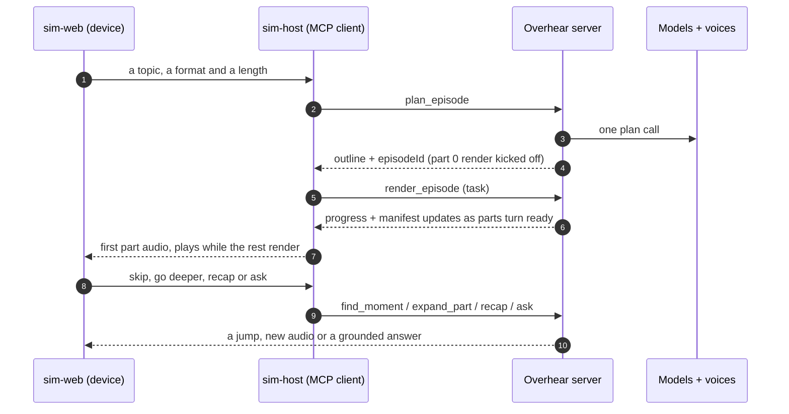

<!-- SPDX-License-Identifier: Apache-2.0 -->

# Architecture

Overhear is an npm workspace of six packages. One package holds every rule, one holds the durable
stores, one is the MCP server, one is the conformance suite and two make up the Alexa+ simulator that
stands in for the device. Strict TypeScript, ESM, Node 22.

## Packages

| Package                    | What it is                                                                                                                                                                     |
| -------------------------- | ------------------------------------------------------------------------------------------------------------------------------------------------------------------------------ |
| `@overhear/core`           | The rules with no I/O: ceilings, ids, the four-format sheet, the prompt builders, the timeline math and the total JSON extractor.                                              |
| `@overhear/durable-stores` | The task store, the task message queue and the resumable event store, each with a SQLite twin and a DynamoDB twin behind one interface. Published on its own under Apache-2.0. |
| `@overhear/server`         | The MCP server: the Hono HTTP app, the Streamable HTTP transport, auth, quotas, the seven tools, the resources, the prompts and the model, voice, storage and fetch adapters.  |
| `@overhear/conformance`    | A client that checks the MCP 2025-11-25 wire over raw HTTP, JSON-RPC and SSE, with no MCP SDK on the test side.                                                                |
| `@overhear/sim-host`       | The device-side MCP client. It bridges the browser to the server, holds the bearer token and proxies media so the token never reaches the page.                                |
| `@overhear/sim-web`        | The Alexa+ simulator UI: the device frame, a gapless Web Audio player, ducking, captions and the outline.                                                                      |

## A request, end to end

1. **One model call to plan.** `plan_episode` turns the source into a titled outline and persists it, then starts a speculative render of the cold open so the first audio is ready without waiting for the whole episode.
2. **Rendering is a task.** `render_episode` scripts, voices and mixes the parts in playback order. The manifest resource updates per part, so a client starts playback on part one and watches the rest arrive.
3. **Steering never blocks playback.** `find_moment` resolves relative moves with the timeline math and never calls the model; `expand_part`, `recap` and `ask` run as tasks that leave the current audio playing.
4. **Tasks belong to their owner.** Every task binds to the bearer principal through the session scope, so a reconnect resumes it and a second principal cannot see it.

## Two run modes, two independent switches

`config.ts` is the only module that reads the environment. It builds a validated config once and prints
both switches in the startup banner, so the run mode is never ambiguous in a log or a demo.

- `OVERHEAR_MODELS` is `mock` or `aws`. `mock` uses deterministic in-process twins for the text model and the voice. The mock audio is a real short MP3 the UI labels "recorded sample", so a judge actually hears the product.
- `OVERHEAR_STORE` is `local` or `aws`. `local` is SQLite plus media on disk. `aws` is S3 plus DynamoDB.
- The default is `mock` + `local`: no AWS account, no credentials, no spend. An AWS store with mock models is refused at boot, because it would write fixtures into DynamoDB.

The AWS path, its exact SDK calls, the table design and a least-privilege IAM policy are in
[docs/AWS.md](AWS.md).

## Durable stores

The task store and the task message queue partition on the resolved principal, so one owner's tasks are
one partition and a foreign principal reads nothing. The event store is per session in local mode,
because the standalone SSE stream carries a fixed id and one shared store would mix two sessions on
replay, which is why local mode is the correct resumable path. Both twins pass the same shared
conformance suite in `@overhear/durable-stores`.

## Security

The threat model, the attacker-by-attacker defences and the file and test behind each one are in
[SECURITY.md](../SECURITY.md). The one release gate that proves it is `./verify.sh`.
